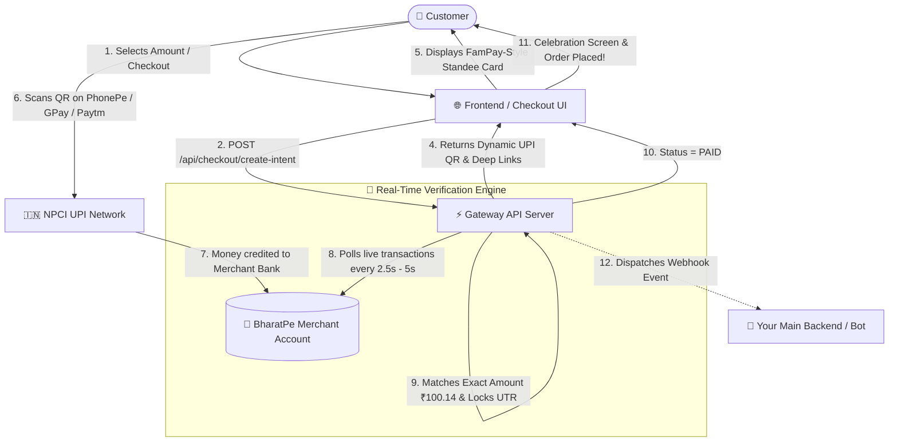

# ⚡ Free UPI Payment Gateway

<div align="center">

[](https://opensource.org/licenses/MIT)
[](https://www.python.org/downloads/)
[](https://fastapi.tiangolo.com)
[]()
[]()

**A 100% Free, Self-Hosted BharatPe Dynamic UPI Payment Gateway with Real-Time Auto-Verification & Zero Transaction Fees.**

[Quick Start](#-quick-start-in-60-seconds) • [Architecture](#-architecture) • [Features](#-key-features) • [API Docs](#-api-reference) • [BharatPe Setup](#-how-to-get-bharatpe-credentials) • [Docker](#-docker-deployment)

</div>

---

## 💡 Why Free UPI Payment Gateway?

Standard payment gateways (Razorpay, Cashfree, PayU, Stripe) charge:
- 💸 **2% to 3% + 18% GST** on every single transaction.
- ⏳ **T+2 or T+3 delayed settlements** to your bank.
- 📋 **Heavy documentation, company registration (Pvt Ltd/LLP), and strict KYC**.

**Free UPI Payment Gateway** bypasses all aggregators by utilizing **BharatPe's zero-fee merchant infrastructure**:
1. **0% Transaction Fees**: 100% of the customer's money goes directly into your bank account.
2. **Instant Settlement**: Direct UPI settlement to your linked bank account.
3. **No KYC / Company Registration Needed**: Works with any standard BharatPe Merchant account.
4. **Collision-Free Auto-Verification**: Uses a unique **Decimal Offset Algorithm** (e.g. ₹100 becomes ₹100.12, ₹100.14) so payments auto-verify in 3 seconds without requiring the customer to type a 12-digit UTR!

---

## 📐 Architecture



---

## 🌟 Key Features

| Feature | Description |
| :--- | :--- |
| **0% Commission** | Free forever. No setup cost, no monthly charges, no per-transaction cuts. |
| **Decimal Offset Engine** | Auto-assigns unique decimal paise offsets (`0.01` to `0.99`) so concurrent payments never collide. |
| **3-Second Auto-Verification** | Background daemon reconciles and verifies received payments automatically in real-time. |
| **Background Reconciler** | Even if the customer closes the browser, switches apps, or disconnects, the payment is verified. |
| **Anti-Fraud UTR Deduplication** | Permanently records claimed UTRs in `used_utrs.json` to prevent replay attacks and double-spending. |
| **FamPay-Style Comic Standee UI** | High-impact Neo-Brutalist checkout standee with neon corner brackets, exact amount copy button, and countdown timer. |
| **Branded Poster Generator** | Generates high-res 800x1080 payment posters on client Canvas and server PIL for instant download. |
| **Manual UTR Fallback** | Instant fallback accordion for users who pay without exact paise. |
| **Webhook Notifications** | Asynchronously dispatches `payment.succeeded` events to your webhook URL. |
| **Universal UPI Support** | Works seamlessly with **Google Pay, PhonePe, Paytm, BHIM, Cred, Amazon Pay, and all banking UPI apps**. |

---

## 🚀 Quick Start in 60 Seconds

### 1. Clone the repository
```bash
git clone https://github.com/Rajesh248810/free-payment-gateway.git
cd free-payment-gateway
```

### 2. Install dependencies
```bash
python -m venv venv
# On Windows:
venv\Scripts\activate
# On Linux/macOS:
source venv/bin/activate

pip install -r requirements.txt
```

### 3. Configure credentials
Copy the sample environment file:
```bash
cp .env.example .env
```
Open `.env` and fill in your BharatPe credentials (see [How to Get BharatPe Credentials](#-how-to-get-bharatpe-credentials) below):
```env
BHARATPE_MERCHANT_ID=your_merchant_id_here
BHARATPE_TOKEN=your_token_here
BHARATPE_UPI_VPA=your_vpa@unitype
MERCHANT_DISPLAY_NAME=MyStore
```

### 4. Run the server
```bash
python run.py
```
Open your browser at **http://localhost:8000/** to see the interactive Demo Checkout!
API documentation is available at **http://localhost:8000/docs**.

---

## 🔑 How to Get BharatPe Credentials

Getting your BharatPe Merchant ID and Token takes less than 2 minutes:

1. Log in to [https://enterprise.bharatpe.in](https://enterprise.bharatpe.in) using your registered BharatPe mobile number and OTP.
2. Open your browser's **Developer Tools** (`F12` or `Ctrl + Shift + I`) and switch to the **Network** tab.
3. Refresh the page or click on the **Transactions** tab on the BharatPe dashboard.
4. Filter by `transactions` in the Network search box.
5. Inspect the request URL and headers:
   - **`merchantId`**: Visible in the request query URL (`merchantId=XXXXXXXX`).
   - **`token`**: Visible under Request Headers as `token: <your-token-string>`.
   - **`BHARATPE_UPI_VPA`**: Your BharatPe QR UPI ID (visible on your QR standee or profile, usually ends with `@unitype` or `@yesbank`).
6. Paste these three values into your `.env` file. Done!

---

## 📚 API Reference

### 1. Create Payment Intent
`POST /api/checkout/create-intent`

Creates a dynamic payment session with a unique decimal amount and UPI deep links.

**Request Body:**
```json
{
  "amount": 250.0,
  "order_id": "ORD_98765",
  "customer_phone": "9876543210",
  "customer_name": "Amaresh",
  "metadata": {
    "plan": "Premium"
  }
}
```

**Response:**
```json
{
  "success": true,
  "data": {
    "intent_id": "pi_1730000000_1234",
    "order_id": "ORD_98765",
    "base_amount": 250.0,
    "exact_amount": 250.14,
    "expires_at": 1730000600,
    "upi_vpa": "your_vpa@unitype",
    "upi_uri": "upi://pay?pa=your_vpa@unitype&pn=MyStore&am=250.14&cu=INR&mode=02",
    "phonepe_uri": "phonepe://pay?pa=...",
    "gpay_uri": "tez://upi/pay?pa=...",
    "paytm_uri": "paytmmp://pay?pa=...",
    "bhim_uri": "bhim://pay?pa=...",
    "qr_code_url": "https://api.qrserver.com/v1/create-qr-code/?size=320x320&data=..."
  }
}
```

---

### 2. Poll Payment Status
`GET /api/checkout/poll-status?intent_id={intent_id}`

Polls the payment status. If still pending, it queries BharatPe in real time.

**Response (When Paid):**
```json
{
  "success": true,
  "status": "PAID",
  "order_id": "ORD_98765",
  "amount": 250.14,
  "utr": "045183118335",
  "paid_at": 1730000120
}
```

**Response (When Pending):**
```json
{
  "success": true,
  "status": "PENDING",
  "time_remaining": 540,
  "exact_amount": 250.14
}
```

---

### 3. Verify Manual 12-Digit UTR
`POST /api/checkout/verify-utr`

Fallback endpoint if the user paid from an external device or without exact paise.

**Request Body:**
```json
{
  "intent_id": "pi_1730000000_1234",
  "utr": "045183118335"
}
```

**Response:**
```json
{
  "success": true,
  "data": {
    "status": "PAID",
    "order_id": "ORD_98765",
    "utr": "045183118335",
    "amount": 250.0
  }
}
```

---

### 4. Download FamPay-Style Poster
`GET /api/checkout/download-qr?intent_id={intent_id}`

Returns a high-resolution `image/png` branded standee poster formatted with exact amount, brand title, and UPI trust badges.

---

### 5. Webhook Payload (Dispatched on Payment)
If `WEBHOOK_URL` is defined in `.env`, the gateway sends an HTTP POST:

```json
{
  "event": "payment.succeeded",
  "order_id": "ORD_98765",
  "intent_id": "pi_1730000000_1234",
  "amount": 250.14,
  "utr": "045183118335",
  "payer_name": "RAHUL SHARMA",
  "customer_phone": "9876543210",
  "metadata": {
    "plan": "Premium"
  },
  "timestamp": 1730000120
}
```

---

## 💻 Integration Code Snippets

### Python
```python
import requests

# 1. Create session
res = requests.post("http://localhost:8000/api/checkout/create-intent", json={
    "amount": 499,
    "order_id": "ORDER_1001",
    "customer_phone": "9876543210"
}).json()

intent_id = res["data"]["intent_id"]
exact_amt = res["data"]["exact_amount"]
print(f"Tell customer to pay ₹{exact_amt} to QR: {res['data']['qr_code_url']}")

# 2. Poll status
status = requests.get(f"http://localhost:8000/api/checkout/poll-status?intent_id={intent_id}").json()
if status["status"] == "PAID":
    print(f"Order Paid! Bank UTR: {status['utr']}")
```

### Node.js / JavaScript
```javascript
const res = await fetch("http://localhost:8000/api/checkout/create-intent", {
  method: "POST",
  headers: { "Content-Type": "application/json" },
  body: JSON.stringify({
    amount: 499,
    order_id: "ORDER_1001",
    customer_phone: "9876543210"
  })
});
const { data } = await res.json();
console.log(`Scan QR: ${data.qr_code_url} | Amount: ₹${data.exact_amount}`);
```

---

## 🐳 Docker Deployment

Run with Docker in a single command:

```bash
docker compose up -d --build
```
The gateway will start on `http://localhost:8000`.

---

## 🛡️ Security & Anti-Fraud

1. **Anti-Replay Attack**: Once a UTR is claimed for an order, it is permanently locked in `data/used_utrs.json`. Any subsequent attempts to use the same UTR on another order are strictly rejected.
2. **Timestamp Buffer**: Transactions are validated against the creation time of the intent to prevent matching payments received prior to session generation.
3. **Decimal Collision Prevention**: Up to 99 concurrent orders for the exact same rupee value receive unique fractional paise offsets (`.01` to `.99`), guaranteeing 100% accurate attribution.

---

## 🤝 Contributing

Contributions are welcome! If you'd like to improve the UI, add support for more merchant APIs (Paytm for Business, Google Pay for Business), or report issues:
1. Fork the Project.
2. Create your Feature Branch (`git checkout -b feature/AmazingFeature`).
3. Commit your Changes (`git commit -m 'Add AmazingFeature'`).
4. Push to the Branch (`git push origin feature/AmazingFeature`).
5. Open a Pull Request.

---

## 📄 License

Distributed under the **MIT License**. See `LICENSE` for more information.

---

<div align="center">
  <b>Built with ❤️ for Indian Creators, Developers & Small Businesses.</b><br>
  Stop paying 2-3% payment gateway fees. Take back 100% of your revenue.
</div>
